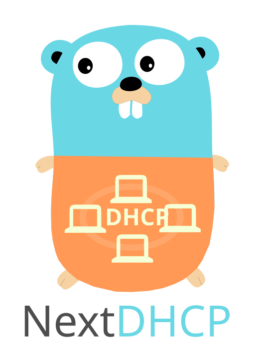

# NextDHCP



[](https://goreportcard.com/report/github.com/nextdhcp/nextdhcp)
[](https://github.com/nextdhcp/nextdhcp/releases)

NextDHCP is an easy to use and extensible DHCP server that chains plugins. It's based on the [Caddy server framework](https://github.com/caddyserver/caddy/) and is thus similar to [Caddy](https://caddyserver.com/) and [CoreDNS](https://coredns.io/). It is still in early alpha and may not yet be considered stable.

<hr color="#6ad7e5">

## Getting Started

### Prerequisites

NextDHCP runs on Linux only: it talks to DHCP clients through AF_PACKET sockets, which other operating systems don't have. You can still work on the code elsewhere, since every package except the `nextdhcp` command itself builds on any system, and build the server for Linux with `GOOS=linux`.

To install, build and test NextDHCP you need [Go](https://go.dev) 1.26 or newer. For testing it is also recommended to have at least one virtual machine available.

### Installing

To install NextDHCP without working on its source code, run:

```
go install github.com/nextdhcp/nextdhcp@latest
```

This installs the NextDHCP binary into `$GOBIN`, or into `$GOPATH/bin` (`~/go/bin` by default) if `GOBIN` isn't set.

To work on NextDHCP, clone the repository and build it:

```
git clone https://github.com/nextdhcp/nextdhcp
cd nextdhcp
go build -o nextdhcp .
```

### Usage

Before starting NextDHCP you need to create a configuration file. A typical configuration file for a local subnet can look like this:

```bash
192.168.0.100 - 192.168.0.200
lease 1h
option {
    router 192.168.0.1
    nameserver 192.168.0.1
}
```

Or, if you need to serve multiple subnets or multiple network interfaces you can also use dedicated blocks:

```
10.0.0.10 - 10.0.0.20 {
    lease 24h
}

192.168.0.1/24 {
    lease 1h
    range 192.168.0.100 192.168.0.200
    option router 192.168.0.1
    next-server 10.1.1.1
}
```

Place your configuration into a file called `Dhcpfile` and start NextDHCP as root:

```
sudo ./nextdhcp
```

## Plugins

- [**log**](./plugin/log) - configure log output and level
- [**database**](./plugin/database) - the lease database to use. Defaults to the builtin [bbolt](https://github.com/etcd-io/bbolt)
- [**ifname**](./plugin/ifname) - sets the network interface a given subnet should be served on
- [**lease**](./plugin/lease) - configures the lease time
- [**nextserver**](./plugin/nextserver) - advertise a TFTP boot server
- [**bootfile**](./plugin/bootfile) - set the boot file for network-booting (PXE) clients, separately for BIOS and UEFI
- [**option**](./plugin/option) - configure any DHCP options
- [**ranges**](./plugin/ranges) - lease IP addresses from pre-defined IP ranges
- [**servername**](./plugin/servername) - sets the server hostname on DHCP messages
- [**static**](./plugin/static) - lease static IP addresses to clients based on their MAC address
- [**gotify**](./plugin/gotify) - send push notifications for IP address leases and DHCP requests via gotify
- [**mqtt**](./plugin/mqtt) - extract and publish DHCP request/response information to MQTT

## Authors

* **Patrick Pacher** - *Initial work* - [ppacher](https://github.com/ppacher)

See also the list of [contributors](https://github.com/nextdhcp/nextdhcp/graphs/contributors) who participated in this project.

## License

This project is licensed under the MIT License - see the [LICENSE](LICENSE) file for details.

## Thank you

This project could not have been built without the following libraries or projects. They are either directly used in NextDHCP or provided a lot of inspiration for the shape of the project:

- [Caddy](https://caddyserver.com)
- [CoreDNS](https://coredns.io)
- [insomniacslk/dhcp](https://github.com/insomniacslk/dhcp)
